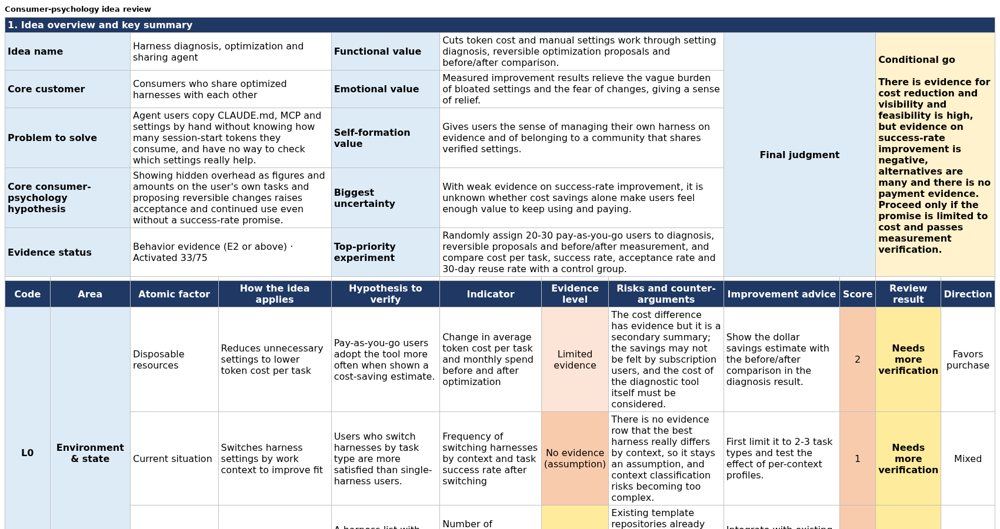

# consumer-atom-review

One product idea in, a review workbook out. Each of 75 consumer-psychology factors ("atoms", 8 layers) is judged against the evidence you supply, and **the compiler, not the model, caps every score by the strength of the evidence**: an assumption can score at most 2 of 5, a statement 3, observed behavior 4, and only payment-backed or repeat-outcome evidence can reach 5.



`sample_output/review-en.xlsx` is a real result for the example in `examples/` (33 of 75 atoms activated, mean score 2.03/5, verdict "conditional go"). Its free text was translated from the Korean run by hand; the numbers are unchanged.

## Run it

Needs Python 3.10+, `pip install openpyxl`, and the [Claude Code](https://docs.claude.com/en/docs/claude-code) CLI (`claude`) installed and logged in. The model calls are billed to your own account.

```bash
python3 review.py --idea examples/idea.txt --evidence examples/evidence.csv --lang en --cap 1.5 --out review.xlsx
```

`--cap` is a hard spending limit in USD for the run. One run of the example cost 0.92 USD and 1.13 USD in two measurements in October 2026 (yours will differ). `--lang ko` writes Korean.

## Your own input

* `idea.txt`: the idea in one or two sentences.
* `evidence.csv`: columns `id,kind,text`. `kind` is `assumption`, `statement`, `behavior`, `payment` or `repeat_outcome` (grades E0 to E4). Quotes in the review must be copied word for word from these rows, so put the source text in `text`.

## What the compiler guarantees (and what it does not)

Checked in code: every atom is answered exactly once; the layer, name and meaning of an atom, its evidence grade and the per-layer table come from the dictionary and your evidence kinds, never from the model; a score above the ceiling for its evidence grade is rejected; the final judgment is limited by the recorded evidence ("go" needs at least half of the activated atoms at grade E3 or above).

Not checked: whether a quote really supports a claim, and whether an atom really drives purchase. The source model is an integrating framework that links several research traditions; it is not a validated standard, and each atom's definition, measurement and causal role need separate validation.

## Files

`review.py` runs everything. `policy.json` is the six-step policy. `consumer_atom_xlsx.py` builds the workbook. `agent_compiler/` is the small, standard-library-only runtime (gate, verifier, state, trace) with the validators of this policy. `examples/` and `sample_output/` show the input and the result. Run directories go to `runs/` (ignored by git).
